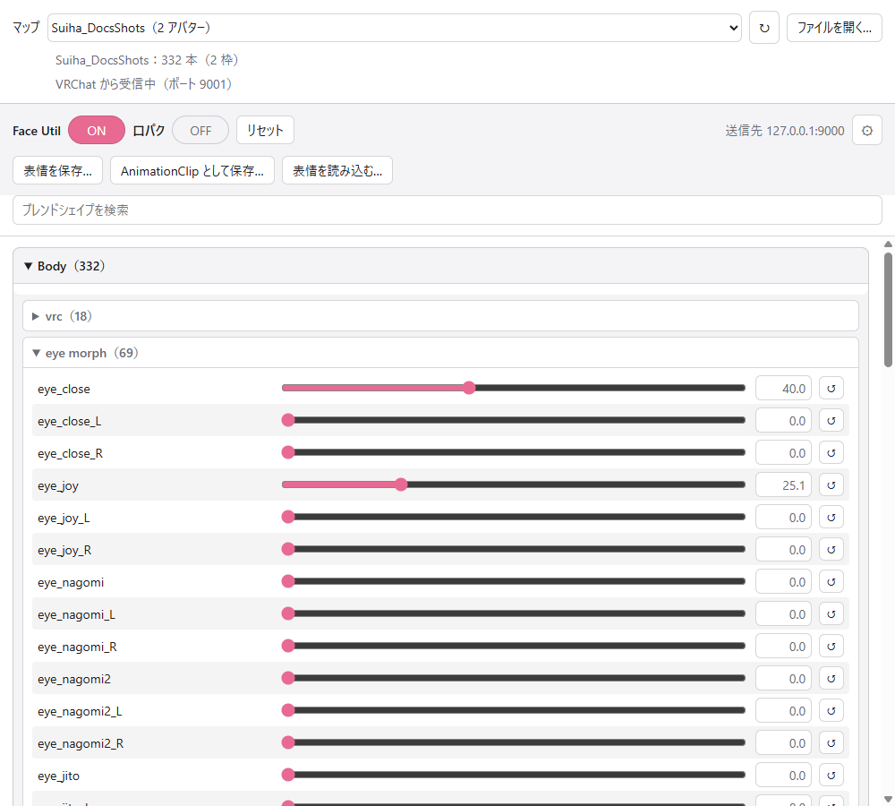

# はじめに

Poyo's Face Util は、VRChat にいるアバターの表情（ブレンドシェイプ）を、VRChat の外から OSC で 1 本ずつ動かすツールです。VRChat の中で見た目を確かめながらスライダーで値を変え、できた表情を Unity の AnimationClip として保存できます。

{ .shot loading=lazy }

## しくみ

| 部品 | 場所 | 内容 |
|---|---|---|
| 受け手 | アバター（Unity のパッケージ） | OSC で受け取った値で、アバターのブレンドシェイプを動かします |
| 送り手 | Windows のアプリ `Poyo's Face Util Sender` | ブレンドシェイプごとのスライダーを並べ、値を OSC で VRChat に送ります |

受け手と送り手は、番号とブレンドシェイプの対応表（マップ）でつながっています。マップは Unity でビルドするたびに書き出され、送り手はそれを読んでスライダーを並べます（[マップ](maps.md)）。

アバターに追加するのは、設定を持つコンポーネント 1 つと Expression Menu の項目だけです。FX のレイヤーとパラメータは、Play Mode に入るときとアップロードするときに組み込みます。コンポーネントはアップロードするアバターには残りません。

## できること

- 登録したブレンドシェイプを、0〜100 の値で 1 本ずつ動かす
- 作った表情を、表情ファイルや AnimationClip に保存する。保存したものを読み込んで、また動かす
- VRChat でアバターを変えると、送り手のマップをそのアバターのものに切り替える

次のことはできません。

- ブレンドシェイプ以外（マテリアルやボーン）を動かすこと
- VRChat から今のブレンドシェイプの値を読み取ること
- AnimationClip の時間の変化を再生すること（読み込むのは最初の値だけです）
- Windows 以外で送り手を動かすこと
