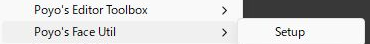
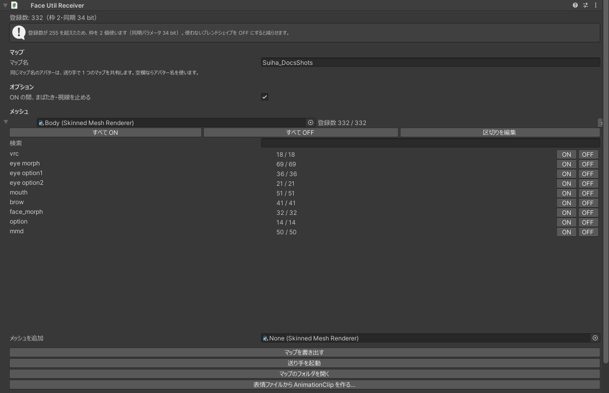
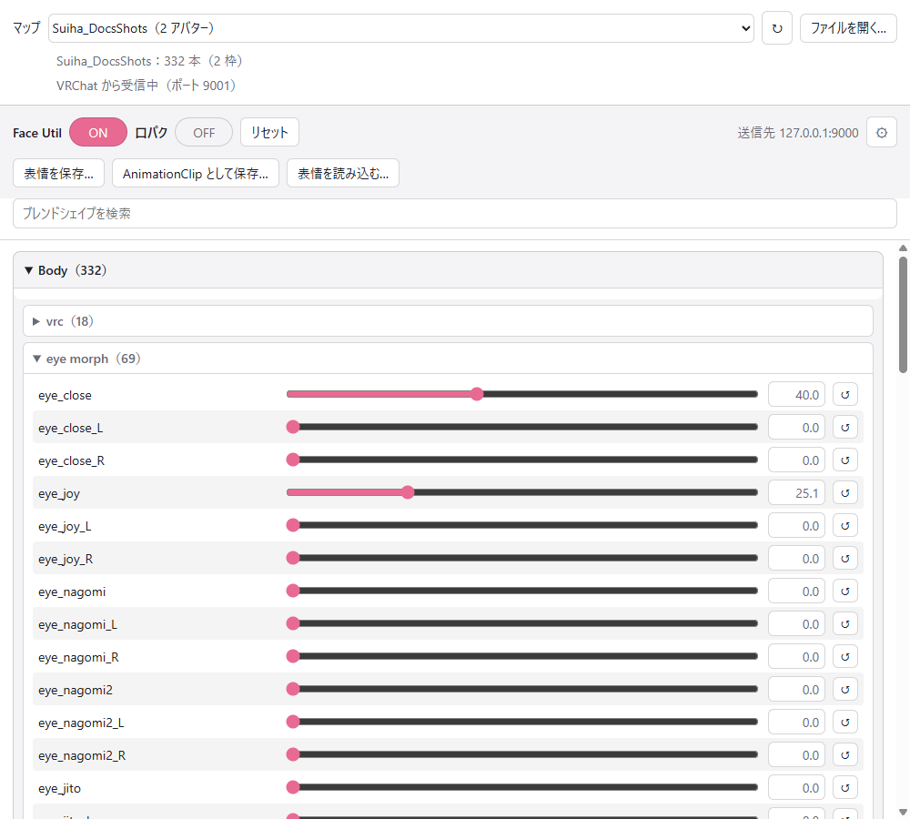

# クイックスタート

アバターに受け手を組み込み、VRChat で表情を動かすまでの手順です。

## 1. 受け手を追加する

Hierarchy でアバター（`VRC Avatar Descriptor` が付いたオブジェクトか、その子）を右クリックし、`Poyo's Face Util` → `Setup` を選びます。

{ .shot loading=lazy }

アバターの直下に `Face Util` オブジェクトができ、`Body` メッシュが登録されます。Expression Menu には `Face Util` のサブメニュー（`ON` と `口パク`）が加わります。

Setup は `Ctrl + Z` で取り消せます。同じアバターで 2 回 Setup しても、2 つ目は作りません。

## 2. 動かすブレンドシェイプを選ぶ

`Face Util` オブジェクトを選び、Inspector で動かすブレンドシェイプを確かめます。最初は、登録したメッシュのブレンドシェイプがすべてオンです。

{ .shot loading=lazy }

!!! warning
    Face Util を ON にしている間は、登録したブレンドシェイプがすべて送り手の値になります。体型の調整や衣装用の縮小など、表情に使わないブレンドシェイプはオフにしてください（[受け手の設定](receiver.md)）。

## 3. アップロードする

いつもどおりアバターをアップロードします。

## 4. VRChat で OSC を有効にする

VRChat の Action Menu で、Options → OSC → `Enabled` をオンにします。

## 5. 送り手で動かす

1. Unity で `Face Util` の Inspector を開き、`送り手を起動` を押します。そのアバターのマップを開いて送り手が起動します。
2. VRChat でアップロードしたアバターに着替えます。
3. 送り手のスライダーを動かすと、アバターの表情が変わります。送り手は起動したときに Face Util を ON にします。

{ .shot loading=lazy }

| 操作 | 内容 |
|---|---|
| `Face Util` のトグルをオフ | ふだんの表情に戻ります。スライダーの位置は残ります |
| `Face Util` のトグルをオン | スライダーの表情に戻ります |
| `リセット` | スライダーと表情を既定の値に戻します |
| `表情を保存…` / `AnimationClip として保存…` | 表情を保存します（[表情と AnimationClip](expressions.md)） |

動かすブレンドシェイプを変えたときは、アップロードし直してください。マップはビルドするたびに新しくなりますが、VRChat のアバターはアップロードし直すまで前のままです。
