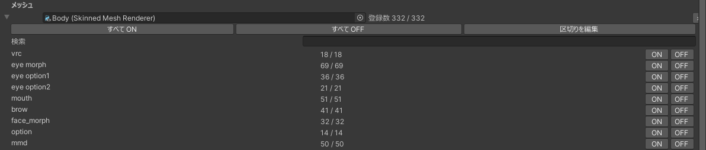

# 受け手の設定

Setup で作った `Face Util` オブジェクト（`Face Util Receiver`）の Inspector で、動かすブレンドシェイプやマップ名を設定します。

| 区画 | 内容 |
|---|---|
| 状態表示 | 登録した数と、使う同期パラメータの量 |
| マップ | マップ名 |
| オプション | ON の間のまばたきと視線 |
| メッシュ | 登録したメッシュと、ブレンドシェイプごとのオン・オフ |
| ボタン | マップの書き出し、送り手の起動など |

## 状態表示

いちばん上に `登録数: N（枠 C・同期 B bit）` と出ます。

| 表示 | 内容 |
|---|---|
| 登録数 | オンにしたブレンドシェイプの数です。区切りと固定されるものは数えません |
| 枠 | 同期パラメータの組の数です。255 本ごとに 1 つ増えます |
| 同期 | 使う同期パラメータの量です。255 本までは 18 bit で、枠が 1 つ増えるごとに 16 bit 増えます |

VRChat の同期パラメータの上限（256 bit）は、アバターのほかのギミックと合わせた数です。表情に使わないブレンドシェイプはオフにして、登録数を減らしてください。登録できるのは 3825 本までです。

## マップ

`マップ名` は、送り手で使うマップのファイル名です。Setup したときに、アバターの名前が入ります。空欄にすると、アバターの名前を使います。

同じマップ名のアバターは、1 つのマップを使います（[衣装違いのアバターでマップを使う](maps.md#share)）。

## オプション

| 項目 | 既定 | 内容 |
|---|---|---|
| `ON の間、まばたき・視線を止める` | オン | Face Util が ON の間、VRChat の自動のまばたきと視線の動きを止めます |

口パクは、Expression Menu か送り手の `口パク` で切り替えます（[口パクとまばたき](tracking.md)）。

## メッシュ

登録したメッシュごとに、折り畳めるブロックが並びます。

| 操作 | 方法 |
|---|---|
| メッシュを追加する | いちばん下の `メッシュを追加` に SkinnedMeshRenderer をドラッグ＆ドロップします |
| メッシュを外す | ブロックの見出しの `×` を押します |
| 1 本ずつオン・オフ | ブレンドシェイプ名の左のチェック |
| まとめてオン・オフ | `すべて ON` / `すべて OFF`。そのメッシュのブレンドシェイプすべてが対象です |
| 名前で絞り込む | `検索` に名前の一部を入れます。大文字と小文字は区別しません |

絞り込んでいるときも、`すべて ON` / `すべて OFF` は表示されていないものを含めて切り替えます。

ブロックの見出しの `登録数 a / b` は、オンにした数（a）と、動かせるブレンドシェイプの数（b）です。

### 区切り

`---目---` や `===口===` のような、形を変えないブレンドシェイプでカテゴリを分けているアバターがあります。これを区切りとして扱い、次の区切りまでを 1 つのグループに折り畳みます。

次のどちらかに当てはまるものを、区切りと判定します。

| 条件 | 例 |
|---|---|
| 名前の先頭か末尾に `-` `=` `－` `＝` `─` `━` `―` が 2 つ以上続く | `---目---`、`==Mouth==`、`Eye--` |
| 名前の先頭か末尾が記号で、形を変えない | `【目】`、`★口★`、`#Eye` |

{ .shot loading=lazy }

- 区切りは動かす対象になりません。チェックも出ません。
- グループは最初は閉じています。見出しの `ON` / `OFF` で、そのグループだけを切り替えられます。
- 検索しているときは、グループに分けずに一致したものだけを並べます。

判定が違うときは、`区切りを編集` を押します。ブレンドシェイプのチェックが「区切りにするか」の切り替えになります。自動で判定したものには `（自動）` と出ます。

区切りを変えると、送り手との対応の番号が変わります。区切りを編集したあとや、Face Util を更新して区切りの判定が変わったあとは、アバターをアップロードし直してください。

### 一覧の印

| 印 | 内容 |
|---|---|
| `（口パク）` | VRChat の口パク（Viseme）に使われているブレンドシェイプです |
| `（まばたき）` | VRChat の自動のまばたきに使われているブレンドシェイプです |
| `（固定）` | AAO Avatar Optimizer の Freeze BlendShapes で固定されるブレンドシェイプです。動かせません |

`（口パク）` と `（まばたき）` のものも登録できます（[口パクとまばたき](tracking.md)）。`（固定）` については[ほかのツールとの併用](other-tools.md)を見てください。

## ボタン

| ボタン | 内容 |
|---|---|
| `マップを書き出す` | 今の設定でマップを書き出します。Play Mode に入ったときとアップロードしたときにも書き出します |
| `送り手を起動` | マップを書き出し、そのマップを開いて送り手を起動します |
| `マップのフォルダを開く` | マップの保存先（`%LOCALAPPDATA%\FaceUtil\Maps\`）を開きます |
| `表情ファイルから AnimationClip を作る…` | 送り手で保存した表情ファイルから、このアバター用の AnimationClip を作ります（[表情と AnimationClip](expressions.md#unity)） |

## Expression Menu

`Face Util` オブジェクトには、Modular Avatar の Menu Installer と Menu Item が付いています。メニューの場所は、Modular Avatar のいつもの手順で変えられます。メニューを消しても受け手は動きます。ON・OFF は送り手からできます。

0.2.0 より前に Setup したアバターは、メニューが `ON` のトグルだけです。このときは状態表示の下に `Expression Menu に口パクの切り替えがありません。` と出るので、`メニューに口パクを追加` を押してください。メニューが `ON` と `口パク` のサブメニューになります。
