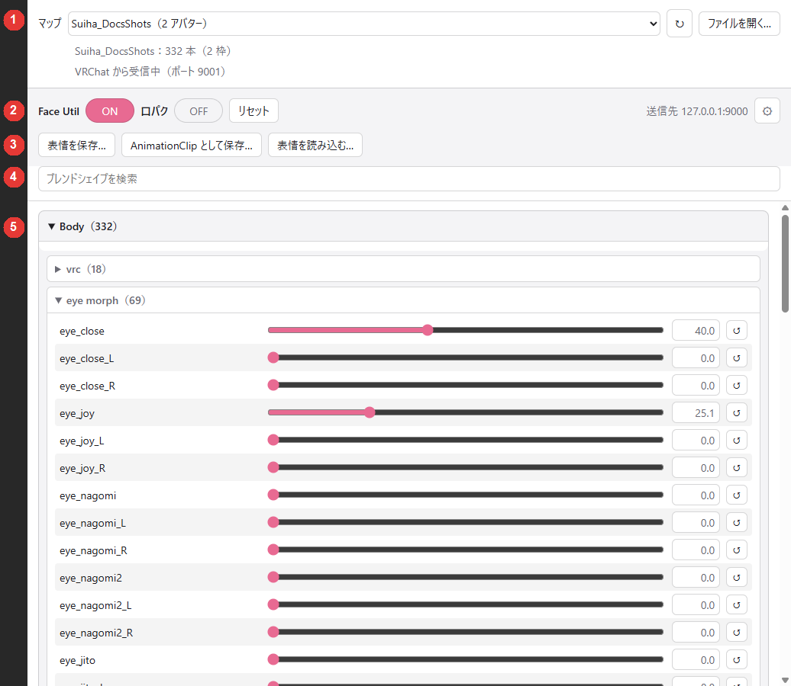
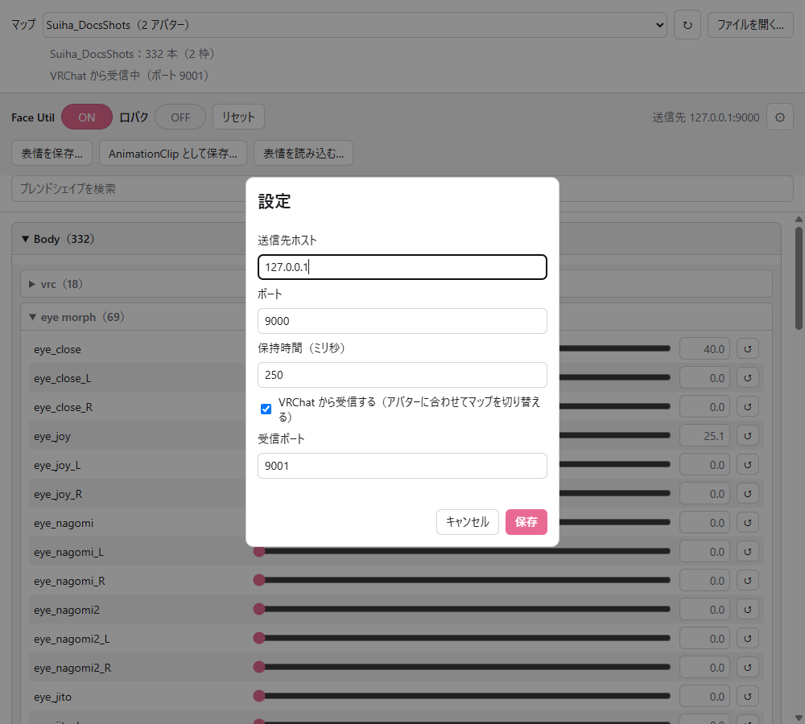

# 送り手の使い方

送り手 `Poyo's Face Util Sender` は、マップを読んでブレンドシェイプごとのスライダーを並べ、値を OSC で VRChat に送るアプリです。

{ .shot loading=lazy }

| 番号 | 区画 | 内容 |
|---|---|---|
| 1 | マップ | 開くマップの選択と、受信の状態 |
| 2 | 操作 | `Face Util` と `口パク` のトグル、`リセット`、送信先、`⚙` |
| 3 | 表情 | `表情を保存…`、`AnimationClip として保存…`、`表情を読み込む…` |
| 4 | 検索 | ブレンドシェイプの名前で絞り込みます |
| 5 | スライダー | メッシュごと、区切りごとに折り畳んだ一覧 |

## マップを選ぶ

| 操作 | 内容 |
|---|---|
| マップの一覧 | `%LOCALAPPDATA%\FaceUtil\Maps\` のマップを、新しい順に並べます |
| `↻` | 一覧を読み直します |
| `ファイルを開く…` | ほかの場所にあるマップ（JSON）を開きます |

いくつかのアバターで使っているマップは、`マップ名（N アバター）` と表示します。VRChat から受信していれば、アバターを変えたときにマップが自動で切り替わります（[マップ](maps.md#switch)）。

マップの下に、受信の状態が出ます。

| 表示 | 内容 |
|---|---|
| `VRChat から受信中（ポート 9001）` | アバターの変更と ON・OFF を受け取っています |
| `受信できません（ポート 9001 を他のアプリが使っている可能性があります）` | 受信だけができません。送信はできます |
| `VRChat から受信しない設定です` | `⚙` で受信をオフにしています |

## トグルとリセット

| 操作 | 内容 |
|---|---|
| `Face Util` | 受け手の ON・OFF です。起動したときは ON です。OFF にするとふだんの表情に戻り、スライダーの位置は残ります。ON に戻すとスライダーの表情に戻ります |
| `口パク` | Face Util が ON の間も口パクを動かすかどうかです。起動したときはオフです |
| `リセット` | スライダーと表情を既定の値に戻します。ON・OFF は変わりません |

Expression Menu の `Face Util` の `ON` と `口パク` を切り替えると、受信しているときは送り手のトグルも変わります。

## スライダー

| 操作 | 内容 |
|---|---|
| スライダー | 値（0〜100）を変えます |
| 右の数値欄 | 0〜100 の数を入れ、`Enter` を押すか、ほかの場所をクリックすると反映します。`Esc` で取り消します |
| `↺` | そのブレンドシェイプを既定の値に戻します |
| 検索欄 | 名前の一部で絞り込みます。一致したものを含むグループが開き、検索を消すと元に戻ります |

- 数値欄には全角の数字も入れられます。範囲の外の数や数字以外を入れると元の値に戻り、`0〜100 の数値を入力してください` と出ます。
- 値は約 0.4 刻みです。`50` と入れると `50.2` になります。

送り手は、ほかのプレイヤーにも同じ表情が届くように、ブレンドシェイプを 1 本ずつ順に送ります。たくさんのスライダーを続けて動かすと、すべてが反映されるまで少し時間がかかります。

## 設定（`⚙`）

{ .shot loading=lazy }

| 項目 | 既定 | 内容 |
|---|---|---|
| 送信先ホスト | `127.0.0.1` | VRChat を動かしている PC です。同じ PC なら変えません |
| ポート | `9000` | VRChat の OSC の受信ポートです |
| 保持時間（ミリ秒） | `250` | 次のブレンドシェイプに切り替えるまでの待ち時間です（100〜1000） |
| VRChat から受信する | オン | アバターの変更と ON・OFF を受け取ります |
| 受信ポート | `9001` | VRChat の OSC の出力を受け取るポートです |

ほかのプレイヤーから見た表情がそろわないときは、保持時間を長くしてください。そのかわり、すべてが反映されるまでの時間は長くなります。

設定は `%APPDATA%\net.maaaaa.face-util.sender\settings.json` に保存します。
